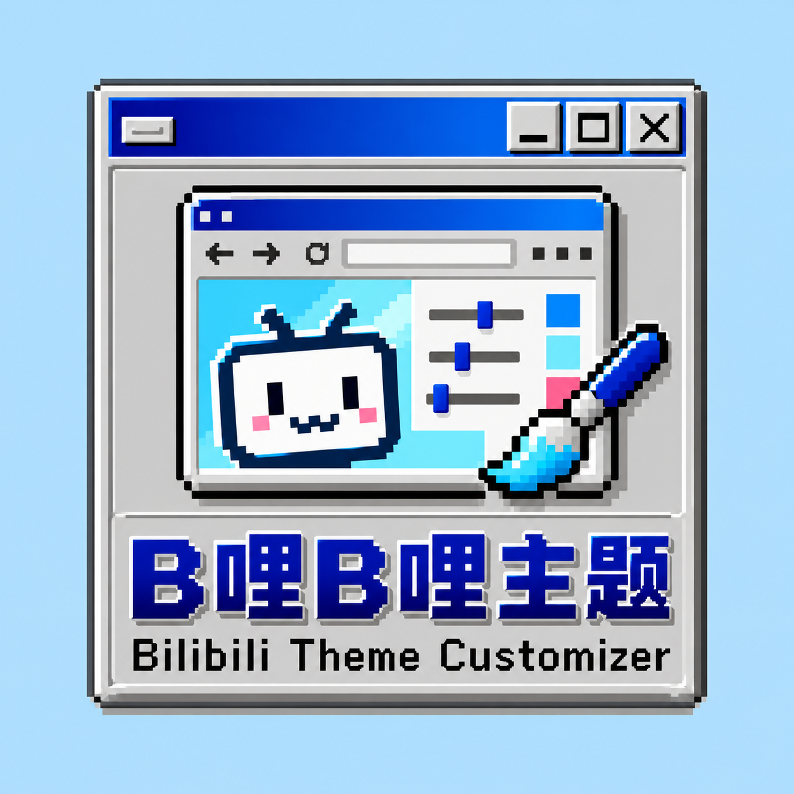

  
  <h1>B哩B哩主题 / Bilibili Theme Customizer</h1>
  
给哔哩哔哩换上你的壁纸和玻璃质感。 Make Bilibili look and feel like yours.

  

    <kbd>🖥️ Chrome / Edge</kbd>
    <kbd>🪟 Windows 98 UI</kbd>
    <kbd>🌐 中文 / English</kbd>
    <kbd>🔒 Local only</kbd>
  

  
<a href="#zh">中文介绍</a> · <a href="#en">English guide</a>

---

## 🇨🇳 中文

这是一个 Chrome / Edge 扩展，可以自定义哔哩哔哩的背景、界面材质和部分导航按钮。控制面板采用 Windows 98 风格，设置保存在浏览器本地。

### ✨ 功能介绍

| 功能 | 说明 |
| --- | --- |
| 🖼️ 自定义背景 | 上传 PNG、JPG、WebP、AVIF、GIF 或 MP4。每个文件最大 **20 MB**。静态图片会缩放并转换为 WebP；GIF 保留动画；MP4 静音循环播放，切走标签页时暂停。 |
| 🧊 磨砂玻璃与透明 | 导航、内容和浮层采用三档有色磨砂玻璃；调整玻璃浓度、模糊强度和点缀色，也可主动切换为透明模式。 |
| 🎨 字体颜色 | 自定义网页文字颜色；输入框底色会随所选文字颜色调整。 |
| 🧭 导航整理 | 分别隐藏顶部左侧、首页频道图标、分类、快捷入口、更多频道和悬浮工具栏中的项目；支持一键隐藏或显示整组。 |
| 🪟 站内界面 | 搜索建议、悬浮菜单、个人资料卡、视频简介和评论区等区域也会应用主题效果。 |
| 🌐 双语面板 | 默认跟随浏览器语言，也可在弹窗中选择“跟随浏览器”、中文或 English；选择会自动保存。 |

在「界面效果」中选择 **磨砂玻璃** 即可使用，不需要开启首页筛选或应用配色预设。导航采用轻档玻璃，视频文字、评论、动态和个人空间面板采用内容档，菜单与弹窗采用更强的浮层档。输入框具有清晰底色、边框与焦点提示。按壁纸明暗采样优先加强面板底色，保留所选文字颜色及其他设置；不添加全页雾层。缩略图、封面和播放器保持清晰，原站布局与断点不变。

### 🚀 安装教程

1. 下载或克隆本项目，保留整个文件夹，包括 `assets` 目录。
2. Chrome 打开 `chrome://extensions/`；Edge 打开 `edge://extensions/`。
3. 打开右上角的**开发者模式**，点击**加载已解压的扩展程序**。
4. 选择**包含 `manifest.json` 的项目文件夹**，不是 `assets` 子文件夹。
5. 打开或刷新哔哩哔哩网页，点击浏览器工具栏中的扩展图标设置背景和效果。

> [!TIP]
> 修改插件文件后，先在扩展管理页点击**重新加载**，再刷新哔哩哔哩标签页。只关闭并重开设置弹窗不会更新网页脚本。

### 🔐 文件与权限

图片和视频只保存在浏览器本地，不会由本插件上传。`storage` 用于保存设置；`unlimitedStorage` 用于容纳最大 20 MB 的背景文件。无需 Node.js、npm 或构建步骤。

🛠️ 点击隐藏按钮没反应，或出现 settings.js 加载错误？

先检查弹窗底部和扩展管理页的错误信息。确认扩展加载的是当前项目文件夹，在扩展管理页点击**重新加载**，然后刷新已打开的哔哩哔哩页面。如果错误列表里只剩旧记录，可以清除记录后再看错误是否重现。

🛠️ 出现 Mixed Content，调用栈指向 syncHeaderGlass？

如果提示包含 `http://i0.hdslb.com/` 和 `automatically upgraded to HTTPS`，表示站点图片仍使用 HTTP 链接，浏览器已将请求升级为 HTTPS。旧版导航玻璃层同步测量尺寸时会触发站点样式计算，让这条警告带上 `content.js` 调用栈。现在测量安排在浏览器布局后，统一读取尺寸再更新玻璃层。

更新文件后，请**重新加载扩展、刷新 Bilibili，再清除旧错误记录**。站点自身的 Mixed Content 提示仍可能出现在页面控制台。浏览器的自动升级行为见 [Chromium 说明](https://blog.chromium.org/2019/10/no-more-mixed-messages-about-https.html)。

### 🧪 开发验证

功能检查结果、自动化测试命令和 Chrome / Edge 手动验收步骤见 [TESTING.md](TESTING.md)。测试工具仅用于开发，扩展仍可直接加载，无需安装依赖或构建。

---

## 🌍 English

A Chrome / Edge extension for customizing Bilibili backgrounds, glass effects, and selected navigation controls. Its settings panel has a Windows 98 style, and settings stay in your browser.

### ✨ Features

| Feature | Description |
| --- | --- |
| 🖼️ Custom backgrounds | Upload PNG, JPG, WebP, AVIF, GIF, or MP4 files up to **20 MB each**. Static images are resized and converted to WebP. GIFs remain animated. MP4 videos loop silently and pause when the tab is hidden. |
| 🧊 Frosted Glass or clear | Three tinted glass strengths for navigation, content and overlays. Adjust strength, blur, accent color and coverage. |
| 🎨 Text color | Pick a page text color. Input backgrounds adapt to keep the text readable. |
| 🧭 Navigation controls | Hide individual items in the top-left navigation, home channels, shortcuts, More menu, and floating toolbar. Hide or show an entire group with one click. |
| 🪟 Site UI | The theme also styles search suggestions, hover menus, profile cards, video descriptions, and comments. |
| 🌐 Two languages | Follow the browser language by default, or choose Auto, 中文, or English in the popup. Your choice is saved. |

Choose **Frosted Glass** under Appearance; it does not require Homepage Filters or a color preset. Navigation uses lighter frost; video cards, comments, feeds and profile panels use stronger content frost; menus and dialogs use the strongest overlay frost. Homepage cards share one surface beneath their sharp thumbnail and text. Category glass follows the actual navigation groups, leaving native outer padding clear, and category links use subtle text-tab states. Homepage search has one tinted shell and focus ring. Bright wallpaper strengthens panel tint before changing foreground contrast, while the saved color and settings remain intact. Thumbnails, covers and player media stay sharp. There is no full-page fog, and native sizing, wrapping and responsive breakpoints remain unchanged.

### 🚀 Installation

1. Download or clone this project. Keep the whole folder, including `assets`.
2. Open `chrome://extensions/` in Chrome or `edge://extensions/` in Edge.
3. Enable **Developer mode**, then click **Load unpacked**.
4. Select the **project folder containing `manifest.json`**, not the `assets` subfolder.
5. Open or refresh Bilibili and click the extension icon in the browser toolbar.

> [!TIP]
> After changing extension files, click **Reload** on the extensions page, then refresh your Bilibili tabs. Reopening the popup alone does not refresh scripts already running in a tab.

### 🔐 Local files and permissions

Background images and videos stay in local browser storage; this extension does not upload them. `storage` saves your settings, while `unlimitedStorage` allows background files up to 20 MB. No Node.js, npm, or build step is required.

🛠️ Hide buttons do nothing, or settings.js fails to load?

Check the popup status and errors on the extensions page. Make sure Chrome or Edge loaded the current project folder, click **Reload**, and refresh open Bilibili tabs. Clear old errors if needed, then check whether a new error appears.

🛠️ Mixed Content warning points to syncHeaderGlass?

A warning containing `http://i0.hdslb.com/` and `automatically upgraded to HTTPS` means a native site image uses an HTTP URL that the browser upgraded to HTTPS. Previously, synchronous glass measurements could flush pending site styles and attach a `content.js` stack to that warning. Measurements now run after browser layout, with geometry reads grouped before glass updates.

After updating, **reload the extension, refresh Bilibili, and clear old errors**. Native site warnings may still appear in the page console. See [Chromium's explanation](https://blog.chromium.org/2019/10/no-more-mixed-messages-about-https.html) of automatic upgrading.

### 🧪 Development checks

See [TESTING.md](TESTING.md) for the feature audit, automated commands, and Chrome / Edge acceptance steps. Test tools are optional; loading the extension still requires no dependencies or build step.

---

## 📁 项目文件 / Project files

| 文件 / File | 用途 / Purpose |
| --- | --- |
| `manifest.json` | 扩展入口、权限和图标 / Extension entry, permissions, and icons |
| `popup.html` · `popup.css` · `popup.js` | 双语设置面板 / Bilingual settings popup |
| `content.js` | 网页背景与玻璃效果 / Page backgrounds and glass effects |
| `theme.js` | 页面识别与组件主题样式 / Page classification and component theme styles |
| `settings.js` | 共用设置和扩展后台 / Shared settings and service worker |
| `assets/logo.png` | 完整 Logo / Full logo |
| `assets/icon-16.png` · `icon-32.png` · `icon-48.png` · `icon-128.png` | 浏览器与弹窗图标 / Browser and popup icons |

## 📄 许可 / License

本项目使用 [GNU GPL v3](LICENSE) 许可。 / This project is licensed under the [GNU GPL v3](LICENSE).

## 原生布局 / Native layout

**哔哩哔哩控制布局，主题控制外观。** 主题不会替换网格、轮播跨度、标题尺寸、频道换行、导航高度、搜索框约束或响应式断点。旧版紧凑导航与自定义网格设置保留在存储中，但已停用；升级后无需重置个人设置。

**Bilibili controls layout; the theme controls appearance.** Header/search sizing, category flow, container margins, grid tracks/gaps, carousel spans, thumbnail ratios, title wrapping and responsive rules stay native. Legacy compact-navigation and custom-grid values remain saved but no longer alter the site.

首页卡片的外层及内部包装可能带有不同的原生上边距，即使未开启筛选也会造成同排缩略图错位。扩展仅减少导致错位的多余正上边距，不生成负边距，不修改缩略图尺寸、原生网格及轮播跨度；主题和筛选均关闭后完整恢复。

Homepage card slots and nested wrappers can carry unequal native top margins, including with filters off. The extension removes only excess positive margins; it never creates negative offsets or changes thumbnail dimensions, grid rules or carousel spans. Turning off both the theme and filters restores original margins.

The category bar uses one padded glass paint layer behind its native groups. Video glass follows each content shell rather than stretched grid items. Floating controls receive individual glass surfaces, with a transparent toolbar wrapper. Native loading skeletons and blocked-media states use shared adaptive colors; pending content remains intact. Ad filtering removes only slots with explicit ad markers or attributes, including bare feed wrappers.

Use **Homepage Filters** to explicitly hide ads, banner artwork, carousel, selected categories, decorations or promotional toolbar entries. Filtering is off by default and can work independently of the theme. Hiding banner artwork retains its native space so the header and categories keep their original flow. Registered ad slots are hidden as complete units; native grid placement reflows the remaining content. Ordinary titles and creators are never matched as ads.

**Apply Glass Colors** changes only the material, colors, strength and optional background palette. It preserves wallpaper/media, navigation choices and filter preferences. The palette affects only the default homepage wallpaper. Glass uses tinted native backgrounds and separate, non-interactive blur layers that follow native rectangles. The layers never filter text or media and never change native layout or event targets.

| Glass level | Components | Default blur / base tint alpha |
| --- | --- | --- |
| 1: navigation | Top/category bars, search navigation, profile/feed tabs, individual floating controls | 12px / .24 |
| 2: content | Video information, right sidebar, comments, dynamic/community cards, profile panels, floating tool panels | 18px / .46 |
| 3: overlays | Menus, suggestions, popovers, dialogs, tooltips | 20px / .66 |

These defaults follow the existing strength/blur controls. Wallpaper sampling increases tint where needed; existing custom images/GIFs/MP4s remain visible. No-backdrop and reduced-transparency modes use a .94 tint fallback. Clear mode and explicitly zero strength remain available. Nested content shares its outer glass surface rather than adding another blur layer.

[TESTING.md](TESTING.md) explains native/themed comparisons at seven widths, continuous resizing, stylesheet auditing, browser regression coverage and live-reference limitations.
